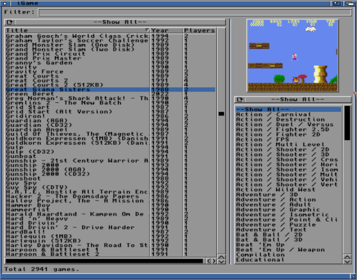

## Notice of License and Restrictions

This repository and the project within it are licensed under the GNU General Public License version 3 (GPL-3). While this license allows users to freely use, modify, and distribute the code, it is important to adhere to the following restrictions concerning its use:

- **Official Releases**: The official releases of this project are made exclusively from this repository. Any distribution or claim of the project that does not originate from this repository is unauthorized and may lead to legal repercussions.

- **Respect for Originality**: Users must not create or release new projects that closely resemble this project. This includes, but is not limited to, using similar names, branding, GUI interface, or functionality that may lead to confusion or misrepresentation.

- **No Theft of Code or Assets**: Users are expressly prohibited from taking the code, images, or any other assets associated with this project and using them in new projects without proper attribution and adherence to the GPL-3 license.

- **Attribution Requirement**: If you distribute or modify this project, it is mandatory to provide proper attribution to the original work, clearly indicating the source and the license under which it is provided.

- **Legal Consequences**: Any attempt to infringe upon this project by using similar names, logos, or branding, or by misappropriating its code or images, will be treated as a violation of copyright law and may result in legal action.

By using this repository, you agree to comply with these terms and acknowledge the rights of the original creator.

## Description

iGame is a frontend to launching WHDLoad games and demos for the Amiga. It is based on Magic User Interface and it works on AmigaOS 3.x Classic Amiga computers, AmigaOS 4 and MorphOS systems.

http://winterland.no-ip.org/igame/

## Builds and releases

The iGame_rel folder should contain builds that are done at some point in time, following any major code changes.

## Installing

Just place the iGame folder anywhere you want on your drive. iGame also is looking for the following libraries. Some of them are required to have it working. If any of them is missing, an alert window will show up.

 - Kickstart 2.04 or higher
 - Workbench 2.1 or higher
 - MUI 3.8 or higher
 - icon.library v37+ (v44+ Recommended)
 - guigfx.library (optional)
 - render.library (optional)
 - guigfx.mcc (optional)
 - Texteditor.mcc
 - NListviews.mcc
 - Urltext.mcc (optional)

Make sure your installation contains MUI and the above libraries. You can find the latest versions in Aminet.

## Compiling

Please check the [Wiki](https://github.com/MrZammler/iGame/wiki/Compiling-iGame)

## Contributing

Please do :-)

iGame is being translated using Weblate, a web tool designed to ease translating for both developers and translators. If you would like to contribute to translation of iGame, you need to register on [https://translate.igame.rocks](https://translate.igame.rocks). Once you have activated your account, proceed to the translation section.

If you would like to contribute with code, please create pull requests to this repository.

## Usage

Docs for the usage of iGame can be found inside the guide directory. The guide will be packed inside iGame releases and
can also be brought up by pressing the Help key when running iGame.
